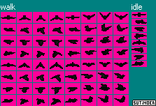
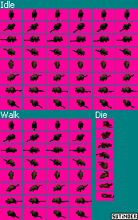

# Diablo sprites — acervo de estudo e construção de animações

Coleção **intencionalmente parcial** de sprites associados a **Diablo II clássico e Lord of Destruction**, organizada para estudar arte raster, animação multidirecional, composição modular, efeitos e cenários. Objetivo futuro: construir um processo de IA que produza personagens **originais**, consistentes entre frames, ações e direções, com qualidade de movimento e acabamento comparável à referência.

A auditoria considera os arquivos reais do commit `da3fd762ee2f5463e652d820e69ab1e12662aae6`. Não é um dump completo dos recursos do jogo nem um dataset já recortado, rotulado e aprovado para treinamento.

## O que existe

| Pasta | Imagens | Conteúdo concreto |
|---|---:|---|
| `sprites/Animais` | 16 PNG | Fauna pequena, camelo, vaca, aves, insetos e outros animais de ambientação |
| `sprites/Classes` | 20 GIF | Sete classes; variações de armadura e dois escudos pesados de Paladin |
| `sprites/Inimigos` | 24 | 20 PNG + 4 GIF; famílias de monstros, variantes de armas, Andariel, Duriel e Diablo |
| `sprites/Npcs` | 39 PNG | NPCs nomeados, figurantes, mercenária Rogue, Valkyrie e aparições/espíritos |
| `sprites/Objects` | 18 PNG | Fogo, lareiras, teleportadores, altar, armadilha, barril, efeitos e objetos |
| `sprites/Parts/Rogue Parts` | 14 PNG | Corpo, cabeça, mãos, ombreiras e arcos da Rogue, incluindo duas variantes “Unused” |
| `sprites/Tiles/Act 1` | 22 PNG | Pisos, paredes, arquitetura e objetos de ambientes do Ato I |
| Auxiliar | 1 ZIP | Projeto TypeScript/Next.js, inspecionado e excluído do corpus visual |

**Total: 154 arquivos originais; 153 imagens = 129 PNG + 24 GIF; 1 ZIP.** Os 24 GIFs são **folhas estáticas com um quadro de arquivo**, e não previews animados. A quantidade total de poses/frames desenhados não é igual a 153 e ainda não possui anotação integral. Veja a diferença e as contagens verificadas em [Frames e layouts](docs/FRAMES.md).

### Cobertura das classes

| Classe | Light | Medium | Heavy |
|---|:---:|:---:|:---:|
| Amazon | ✓ | — | ✓ |
| Assassin | ✓ | ✓ | ✓ |
| Barbarian | ✓ | ✓ | ✓ |
| Druid | ✓ | ✓ | ✓ |
| Necromancer | ✓ | ✓ | ✓ |
| Paladin | ✓ | ✓ | Heraldic Shield + Tower Shield |
| Sorceress | ✓ | — | ✓ |

Ausências são parte do recorte do acervo. Light/Medium/Heavy identificam variantes visuais do material exportado; não são um ranking de qualidade ou nível do personagem. A presença de uma classe não garante todos os equipamentos, transformações, magias ou ações dessa classe.

## Exemplos reais do acervo

| Bird — voo e repouso | Rat — repouso, movimento e morte |
|---|---|
|  |  |

As linhas desses dois exemplos mudam a vista; as colunas mudam a fase **dentro de cada bloco**. A própria célula pode mudar de tamanho entre walk e idle.

## Leia nesta ordem

1. [Inventário completo por arquivo](docs/INVENTORY.md): dimensões, formatos, função e limites de identificação de **cada imagem**.
2. [Funcionamento no Diablo II](docs/DIABLO2.md): gameplay versus apresentação, modos, direções, camadas e formatos nativos.
3. [Frames e posicionamento](docs/FRAMES.md): leitura de folhas, contagens verificadas, coordenadas e armadilhas de extração.
4. [Arte e animação](docs/ART.md): volume, luz, paleta, materiais, movimento e efeitos.
5. [Construção de um pacote original](docs/PRODUCTION.md): da definição do personagem à exportação e integração em engine.
6. [Preparação e treinamento de IA](docs/TRAINING.md): exemplos temporais, rótulos, splits, currículo e avaliação.
7. [Auditoria, lacunas e próximos marcos](docs/AUDIT.md): o que foi comprovado e o que ainda não deve virar rótulo.
8. [Fontes e proveniência](docs/SOURCES.md): referências oficiais, produção original, implementação e cadeia de origem.

## Para que serve e onde usar

- Estudo visual de ARPG isométrico, animação multivista, profissão de NPC, equipamento modular e estados de objeto.
- Preparação de ferramentas de anotação, reconstrução de clipes e comparação de qualidade temporal.
- Referência para um pacote **original** em Godot, Unity, web/Canvas ou outra engine 2D com atlas e metadados.
- Pesquisa de IA: separar qualidade de imagem, consistência temporal, fidelidade direcional e composição de camadas.

Este acervo não é um pacote pronto para arrastar a uma engine: contém fundos opacos, legendas, grades, créditos e regiões vazias. Também não inclui DCC/COF/DT1/DS1, offsets nativos, eventos de ataque ou tabelas de gameplay. PNG/GIF não substituem esses dados em um mod do Diablo II. Para plataforma 2D, a perspectiva e os movimentos exigem uma direção própria; não basta reutilizar todas as orientações isométricas.

## Como começar

Abra as imagens na resolução original; zoom inteiro com nearest-neighbor ajuda a examinar pixels. Para revisar movimento, primeiro recorte uma ação e uma direção: reproduzir a folha inteira ou cada linha inteira pode misturar direções e ações.

```bash
python -m pip install -r tools/requirements.txt
python tools/audit_assets.py --output /tmp/diablo-sprites-audit.json
python tools/extract_examples.py --output /tmp/diablo-sprites-examples
```

O primeiro comando de ferramenta mede as 153 imagens sem alterá-las. O segundo reconstrói **somente os exemplos mapeados**, gera PNGs RGBA e previews GIF com tempo de estudo explicitamente artificial. Não é um extrator universal. Contrato dos recortes: [examples/layouts.json](examples/layouts.json). Os caminhos de saída são de trabalho e não devem substituir `sprites/`.

Exemplo concreto: `Bird.png` tem 64 células de voo (`walk`, 8 × 8) e 8 poses `idle`. `Rat.png` tem 48 células `idle`, 32 `walk` e 8 `die`. `Fire (Large).png` tem três ciclos com 20 células cada. Isso **não** estabelece uma regra geral de oito frames ou oito direções para o restante do acervo.

## Técnica de desenvolvimento

A arte do Diablo II clássico se apoia em **modelos 3D pré-renderizados em sprites 2D**, não em uma regra de desenhar cada pixel manualmente. A produção original utilizou 3D Studio Max para grande parte da arte e Photoshop para texturas/interface; a composição de componentes permite variar equipamento e aparência. Referências em [SOURCES.md](docs/SOURCES.md).

Para desenvolver um pacote comparável, controlar câmera, escala, silhueta, luz, pivô e animação antes da redução é tão importante quanto o acabamento de cada imagem. Na rota por IA, gerar frames independentes sem identidade e geometria compartilhadas tende a produzir oscilação, mudanças de equipamento e deslizamento de pés. O guia propõe ações/direções congeladas, clipes completos e validação de oclusão.

## Origem e condições de uso

O repositório é público; isso descreve acesso, não uma licença dos sprites da Blizzard. No snapshot auditado não há arquivo de licença, identificação do extrator original ou autorização de treinamento. Algumas folhas têm créditos embutidos como “SUTINOER” e “ripped by napalm”; devem ser preservados nos originais e registrados na proveniência. Não atribuímos autoria deste material ao organizador do repositório nem adicionamos uma licença permissiva aos assets. Registrar a base de uso aplicável é uma etapa de preparação do corpus; detalhes em [SOURCES.md](docs/SOURCES.md).

**Estado atual:** inventário técnico integral e guia publicados; exemplos selecionados com coordenadas verificadas. A anotação completa das poses, direções absolutas, tempos nativos e eventos de cada folha permanece uma etapa explícita, não uma propriedade presumida dos arquivos.
