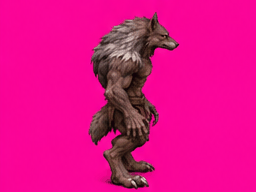
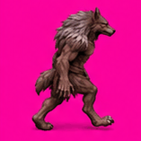

# Lycan — classe original em desenvolvimento

Fontes recuperadas da tentativa interrompida e Walk anexado preservado. **Estudos v1, sem aprovação final e sem integração em engine.**

| Fonte | Organização | Estado |
|---|---|---|
| [Identidade](arte/lycan-turnaround-v1.png) | 4 × 2 vistas estáticas | Recuperada |
| [Idle](arte/lycan-idle-v1.png) | 8 vistas × 4 fases | Recuperado |
| [Walk](arte/lycan-walk-v1.png) | 8 vistas × 8 fases | Anexo original preservado |

Ordem das vistas: S, SW, W, NW, N, NE, E, SE. Linhas de Idle/Walk representam vistas; colunas representam tempo. A grade foi particionada proporcionalmente para inspeção, sem corrigir anatomia ou recentralizar poses. [Manifesto](manifest.json) contém dimensões, hashes e coordenadas; pivôs ainda desconhecidos.

| Idle E — inspeção | Walk E — inspeção |
|---|---|
|  |  |

[Todos os previews](previews/) usam 120 ms por quadro, uma escolha de estudo. Magenta/sombra preservados; estes arquivos não são PNGs RGBA finais.

Leia [Design](docs/DESIGN.md), [Referências](docs/REFERENCIAS.md), [Contrato de animação](docs/ANIMACOES.md), [Roadmap de checkpoints](docs/ROADMAP.md) e [Estado para retomada](AI_STATE.md). [Prompts recuperados](prompts/) cobrem identidade e Idle; o prompt exato do Walk não está disponível.

A recuperação confirma os arquivos, não sua qualidade temporal. Revisar câmera, escala, proporções, patas apoiadas, oclusão e fechamento de loop. Combate, corrida, alpha final, atlas e eventos permanecem pendentes.
